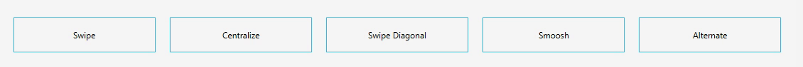

[](https://github.com/Gleidson28/GNCarousel/blob/master/LICENSE) 

<h1> GNButton </h1>

<h5 > 
  JavaFx Button Hover Effect.
</h5>

 > Button with animated background


<h1></h1>

<h5>Basic Usage</h5>

```java
AnimatedButton animatedButton = new SwipeButton();

```

<h1></h1>

<h5>Inline css  </h5>

```css
 -fx-trans-fill: <paint>;
 -gn-trans-text-fill : <paint>;
```
<h5>View</h5>

<p align="center"></p>
